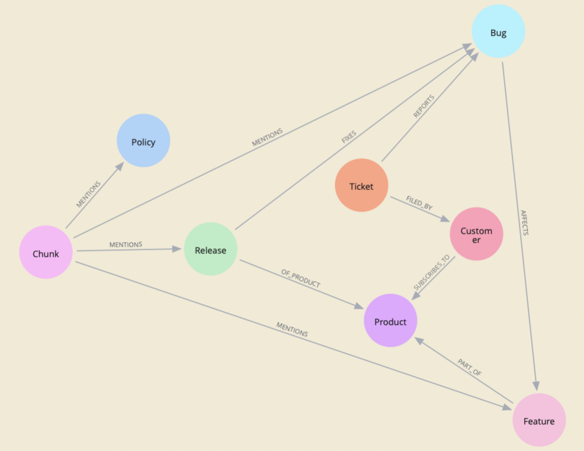
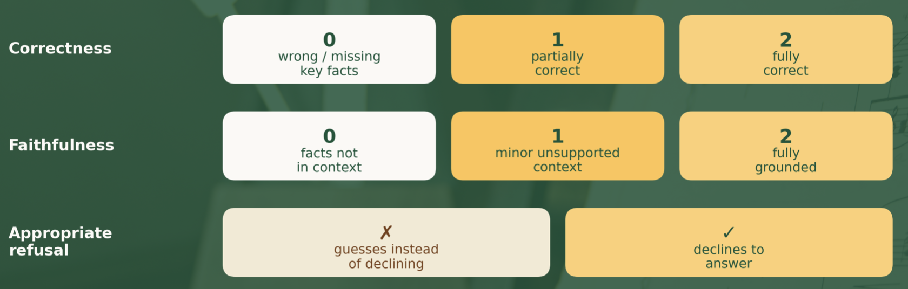
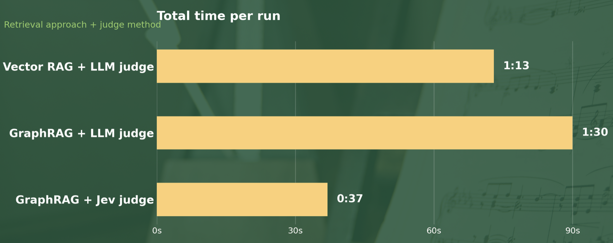

When I first started building RAG demos, I mostly evaluated them the same way many of us probably do: ask a question, read the answer, and decide whether it looks right. That works...but it is manual, subjective, and time-intensive.

A pipeline might give a great answer to the question you happened to try, then give a poor one on a related question, miss relevant context, or confidently make up a detail. And when you change something in the system, such as retrieval strategy, prompt, model, chunking, graph traversal, an "it seems better" evaluation is not concrete evidence.

RAG benchmarking provides a repeatable way to understand whether a RAG pipeline is actually improving, so I spun up a starter project with the https://github.com/JMHReif/graphrag-benchmark-demo[GraphRAG benchmark demo^] repository. The application compares retrieval approaches over a fictional software-support data set, asks a set of questions, and scores the answers.

The deeper I got into it, the more I realized that benchmarking is not really about producing one slide-worthy score. Instead, it is about asking real questions, evaluating multiple criteria, and learning the pipeline's weak spots.

== A benchmark is only as good as its questions

It is easy to write questions that make a particular data set (or retrieval approach) look good. If you know the data model and the documents well, you can accidentally create questions that line up perfectly with its structure. That might prove that the demo works, but it does not tell how the application will behave for real users.

A useful benchmark needs questions that cover the types of things people will actually ask. For this demo, questions are spread across a few categories:

* *Simple factual lookup:* "Which release fixed this bug?"
* *Multi-hop reasoning:* "Which open bugs affect customers on the Enterprise tier?"
* *Comparison or aggregation:* "Which bugs are fixed, and which are still open?"
* *Temporal questions:* "What changed between release A and release B?"
* *Unanswerable questions:* "What is the refund policy for hardware?" when the knowledge base has no such policy.

The last category will flag any outright hallucinations. A response should not receive high marks simply because the answer sounds helpful. Sometimes the best answer is: "I don't have that information."

Questions also need to be easy to maintain and read. This project stores questions (with a golden answer and other metadata) in a JSON file.

[source,json]
----
[
  {
    "id": "Q1",
    "category": "simple_factual",
    "question": "Which release fixed the SAML SSO login timeout bug?",
    "goldAnswer": "Aurora 3.2 fixed BUG-101, the SAML SSO login timeout bug.",
    "unanswerable": false
  },
  ...
  {
    "id": "Q5",
    "category": "multi_hop",
    "question": "Which open bugs affect customers on the Enterprise tier?",
    "goldAnswer": "None. The only open bug, BUG-103 (webhook duplication), was reported by Globex, which is on the Growth tier, not Enterprise.",
    "unanswerable": false
  },
  {
    "id": "Q6",
    "category": "comparison_aggregation",
    "question": "Which reported bugs have been fixed, and which are still open?",
    "goldAnswer": "BUG-101 (SSO Login) was fixed in Aurora 3.2. BUG-102 (Scheduled Workflows) was fixed in Aurora 3.1. BUG-104 (Usage Dashboards) was fixed in Beacon 1.4. BUG-103 (Webhook Triggers) is still open.",
    "unanswerable": false
  },
  ...
  {
    "id": "Q8",
    "category": "temporal",
    "question": "What changed between Aurora 3.1 and Aurora 3.2?",
    "goldAnswer": "Aurora 3.1 fixed BUG-102 (scheduled workflows skipping DST transitions). Aurora 3.2 fixed BUG-101 (SAML SSO login timeouts).",
    "unanswerable": false
  },
  ...
  {
    "id": "Q10",
    "category": "unanswerable",
    "question": "What's the refund policy on hardware purchases?",
    "goldAnswer": "The knowledge base has no hardware refund policy -- the refund policy only covers Aurora and Beacon software subscriptions. The assistant should say it doesn't have this information rather than inventing a hardware policy.",
    "unanswerable": true
  },
  ...
]
----

These points change how we think about benchmark design. We do not just need a collection of questions, but an intentional, editable representation of user needs, including the uncomfortable cases like incomplete information, relationship-heavy questions, comparisons, time-based reasoning, and requests the system should refuse.

That collection can and should start from expert curation and then evolve based on support tickets, user feedback, and production failures. As problems surface, they become new benchmark cases. In that sense, the benchmark becomes a living regression suite for the RAG application.

== One score cannot explain a RAG failure

Another thing that makes sense, but might not be obvious is that a wrong answer does not always point to a retrieval failure.

There are several places a RAG pipeline can go wrong:

* Retrieval can miss relevant context or retrieve irrelevant context.
* The prompt or answer-generation step can misuse perfectly good context.
* The model can add unsupported information anyway.
* The system can answer when it should decline.

This is where measuring answers on separate dimensions helped. Scoring came down to the following criteria:

This separation makes the results more actionable. For instance, there were several answers that looked good on the surface, but the LLM docked their score. Upon closer scrutiny, the answer was missing a required piece from the golden answer such as not clearly stating that the system does not have a hardware policy because it only deals with software.

If an answer is faithful but incomplete, we might have a retrieval problem: the model used what it received, but it did not receive enough. If the answer has the right context but still reaches the wrong conclusion, we need to inspect prompting or generation. If it answers an unanswerable question with confidence, we have a hallucination and guardrail problem. This is much more useful than a single percentage that says the system is "75% accurate."

== LLM-as-judge is powerful, but leaks efficiency and uncertainty

One approach in the demo uses an LLM to compare an answer with a gold reference answer. The judge returns scores for correctness and faithfulness, plus whether an unanswerable question was appropriately refused.

[source,java]
----
    @Override
    public ScoredAnswer score(BenchmarkQuestion question, String actualAnswer) {
        String prompt = """
                You are grading a support assistant's answer against a gold reference.
                Be strict: only award full credit when the answer actually contains the key facts, not just plausible-sounding text.

                <more prompt>
                """.formatted(<params>);
        <more code>
    }
----

I like this because it can evaluate answers that do not match the expected wording exactly. Exact-match evaluation is great for a short, fixed fact, but it falls apart when a valid answer is phrased differently.

However, LLM-as-a-judge is not magic. The quality, speed, cost, and consistency of the evaluation depend on the judge model and how often benchmarks need executed. A judge could be overly generous, overly strict, or inconsistent across runs, and complex judging is more intensive than less-critical spot-checking. In my test results, the judge could correctly identify an answer as broadly correct while still flagging unsupported details, which is exactly what I wanted to see, but also remind me that the evaluator needs scrutiny too.

The cautious part of me would treat LLM judging as a tool, rather than a golden rule. If a benchmark score changes, I want confidence that the pipeline changed and not uncertainty that the judge had a different interpretation today.

== Decision models evals faster, but requires a different approach

I also experimented with a decision-model-style scorer. Rather than asking a model to generate a written evaluation, the scorer asks constrained questions such as:

* Is this answer wrong, partially correct, or fully correct?
* Is it unsupported, mostly grounded, or fully grounded?
* Did it appropriately refuse?

This is a different interaction than "read this answer and write a critique." The evaluator is selecting or weighting defined outcomes. 

[source,java]
----
    @Override
    public ScoredAnswer score(BenchmarkQuestion question, String actualAnswer) {
        <more code>

        Map<String, Object> body = Map.of(
                "state", state,
                "model", model,
                "questions", Map.of(
                        "correctness", scoreQuestion(
                                "Be strict: only award credit when the system's actual answer actually "
                                        + "contains the key facts from the gold reference, not just plausible-sounding text. "
                                        + "How correct is the actual answer?",
                                CORRECTNESS_LEVELS),
                        "faithfulness", scoreQuestion(
                                "How well is the actual answer grounded in real, supported context, "
                                        + "as opposed to fabricated or invented detail?",
                                FAITHFULNESS_LEVELS),
                        "refusal", noulQuestion(
                                "This question is intentionally unanswerable from the knowledge base. "
                                        + "Did the system plainly decline instead of guessing?")
                )
        );

        <more code>
    }
----

In the demo, this reduced scoring time substantially: the GraphRAG run with the LLM judge took about a minute and a half, while the decision-model judge run took under forty seconds.

That speed is appealing when a benchmark grows from a dozen questions to hundreds or thousands. But it also changes the work required up front. Questions and expected answers need to be more specific and designed so they can be evaluated against clear criteria. 

I have seen recent recommendations (e.g. https://youtu.be/P0suQ_Nxyso[NODES 2026 session^]) that decisions models are better at smaller, refined decisions, rather than broad, multi-point decisions. It could mean breaking down more complex questions or refining score criteria. It is something I plan to dig into a bit more, but worth mentioning that trading a regular LLM for a decision model is not a 1:1 swap.

In other words, you have to design the benchmark solution with your planned architecture/tools in mind.

== Benchmark the results, not the tech stack

The point of this work is not to prove that GraphRAG always wins over vector RAG. It will not. Different questions require different retrieval strategies. A straightforward factual question may work well with vector retrieval. A question that requires following relationships across customers, tickets, bugs, features, and releases may benefit from graph expansion. A question with no answer should result in a refusal, regardless of the retrieval architecture.

Category-level results are more interesting to me than an overall winner because it highlights which parts of the pipeline are best, fastest, cheapest, etc for different questions. The goal of a benchmark should be evidence about the true quality and value of the system. It should help us make a design decision, not just tout an optimal stack.

== What I am taking forward

I am still learning in this area, but these are the practices I plan to keep:

* Start with real user tasks, not only questions tailored to the data model.
* Include answerable and unanswerable cases.
* Cover several reasoning patterns instead of optimizing for one.
* Score correctness and grounding separately.
* Keep a baseline and compare changes by question category.
* Treat judges as evaluators that also need evaluation.
* Add production failures back into the benchmark over time.

The biggest shift for me has been moving from "Does my RAG demo answer this question?" to "What are my criteria for a good answer and does the actual answer meet all of them?" That feels like a much better question to ask before calling a RAG pipeline production-ready.

Happy coding!

== Resources

* Code repository: https://github.com/JMHReif/graphrag-benchmark-demo[GraphRAG Benchmark Demo^]
